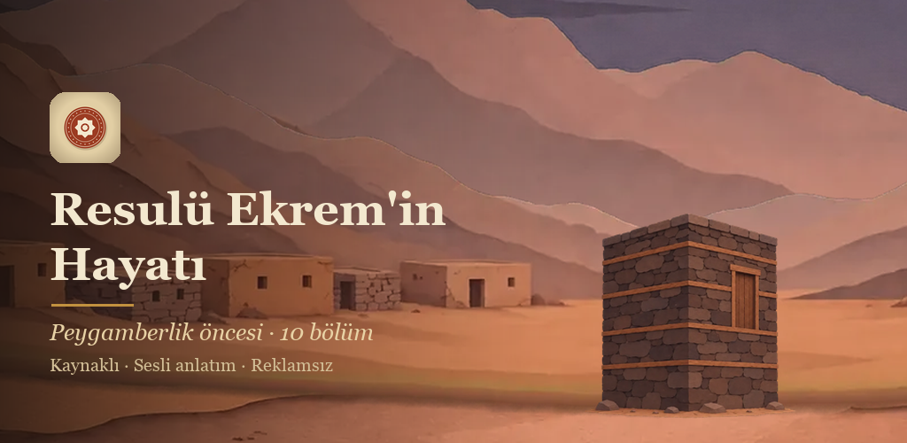
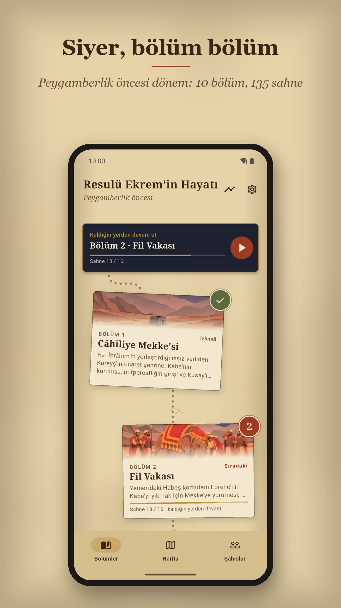
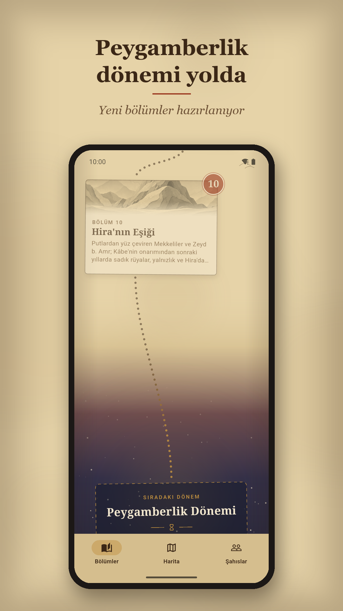
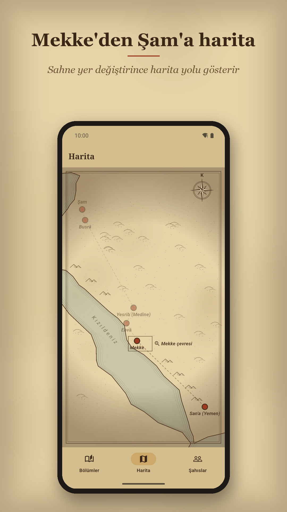
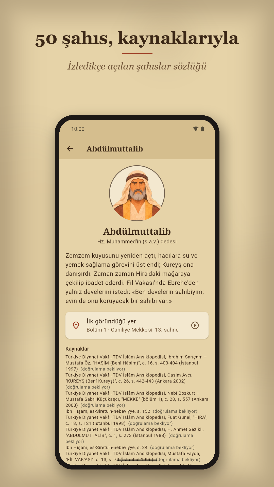
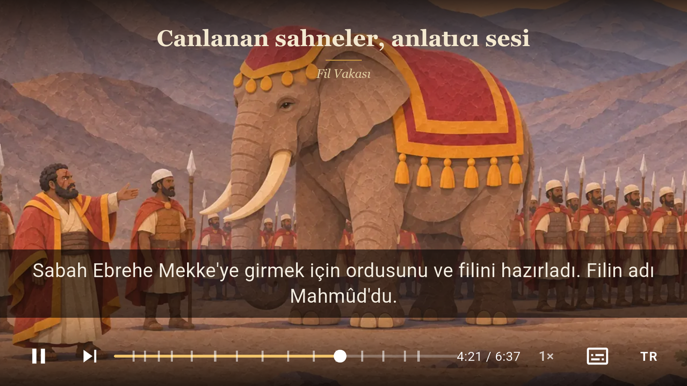
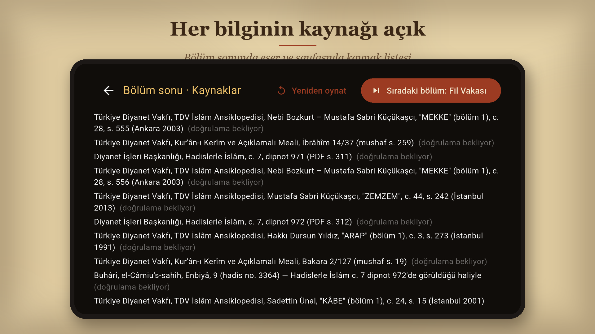

<p align="center">
  
</p>

<h1 align="center">Resulü Ekrem'in Hayatı</h1>

<p align="center">
  Hz. Muhammed'in (s.a.v.) hayatını bölüm bölüm, hareketli illüstrasyonlar ve anlatıcı sesiyle anlatan,<br>
  <b>her cümlesi kaynağa bağlı</b>, ücretsiz ve reklamsız bir mobil uygulama.
</p>

<p align="center">
  
  
  
  
  
</p>

<p align="center">
  
  
  
  
</p>
<p align="center">
  
  
</p>

---

## Nedir?

Uygulama, siyeri **video dosyası olmadan** anlatır: her bölüm, uygulamanın içinde oynatılan katmanlı sahnelerden oluşur. Gökyüzü, dağlar, şehir ve figürler ayrı katmanlardır; kamera bunların arasında yavaşça gezinir, anlatıcı konuşurken altyazı akar. Sahne başka bir şehre geçtiğinde parşömen bir harita açılır ve yolculuğu gösterir.

İlk sürüm **peygamberlik öncesi dönemi** anlatır:

| # | Bölüm | | # | Bölüm |
|---|---|---|---|---|
| 1 | Câhiliye Mekke'si | | 6 | Ebû Tâlib'in Himayesi |
| 2 | Fil Vakası | | 7 | Gençlik |
| 3 | Doğum | | 8 | el-Emîn |
| 4 | Süt Annenin Yurdu | | 9 | Hakem |
| 5 | Yetimlik | | 10 | Hira'nın Eşiği |

**135 sahne · yaklaşık 42 dakika anlatım · 50 şahıs · 11 yer · Türkçe ve İngilizce altyazı.** Peygamberlik dönemi hazırlanıyor.

## İlkeler

**Kaynaksız cümle yok.** Uygulamaya giren her tarihî bilgi bir *iddia* kaydına, her iddia en az bir kaynağa bağlıdır: Kur'ân-ı Kerîm, Buhârî ve Müslim'in *Sahîh*'leri, İbn Hişâm'ın *es-Sîre*'si, TDV İslâm Ansiklopedisi. Her bölümün sonunda o bölümün kaynakları eser ve sayfasıyla listelenir. Rivayetler ayrıştığında ana metne en güçlü rivayet girer, diğerleri dipnot olur. Yorum ve hüküm katılmaz. Ayrıntı: [`docs/KAYNAK_POLITIKASI.md`](docs/KAYNAK_POLITIKASI.md).

**Temsilde edep.** Hz. Peygamber yüz ve beden ayrıntısı olmadan, yalnız nur olarak gösterilir ya da sahne onun gözünden görülür. Diğer peygamberler figür olarak çizilmez. Anne-babası, eşleri ve süt annesi yüzleri gösterilmeden anlatılır. Onun sözleri için karakter sesi yoktur; yalnız anlatıcı, rivayetteki hâliyle aktarır. Ayrıntı: [`docs/GORSEL_USLUP.md`](docs/GORSEL_USLUP.md).

**Kullanıcıya saygı.** Hesap yok, sunucu yok, reklam yok, analitik yok. İlerleme yalnız cihazda saklanır. [Gizlilik politikası](https://yerdema.github.io/siyer-gizlilik/).

## Özellikler

- 🎞️ Katmanlı, hareketli sahneler ve anlatıcı sesi; 1,5× ve 2× hız, sahne atlama
- 🗺️ Mekke'den Şam'a parşömen harita; sahne yer değiştirince harita geçişi
- 📜 Bölüm sonunda kaynak listesi, Ayarlar'da tam kaynakça
- 🕰️ Zaman çizelgesi ve 50 kişilik şahıslar sözlüğü (izledikçe açılır)
- 🌐 Türkçe / İngilizce arayüz ve altyazı; oynatırken TR ⇄ EN
- 🔒 Kilit ekranı kartı: ekran kapalıyken dinleme, durdurma, sahne atlama
- 📦 İlk bölüm uygulamayla gelir; diğerleri açılınca bir kez iner (3–10 MB), sonra çevrimdışı

## Nasıl çalışır?

```
content/                    içerik (koddan ayrı, JSON + medya)
├── tr/bolumler/*.json      bölümler: sahneler, anlatım metni, iddialar ve kaynakları
├── tr/ses/*.mp3            sahne başına anlatım sesi
├── tr/*.json               şahıslar, yerler, zaman çizelgesi, kaynakça
├── en/                     İngilizce altyazı ve yan veri çevirileri
└── gorseller/*.webp        sahne katmanları (1536×864, şeffaf WebP)
app/                        Flutter uygulaması
├── lib/oynatici/           sahne çizici, kamera, zaman planı, ses, harita geçişi
├── lib/ekranlar/           bölüm yolu, harita, şahıslar, zaman çizelgesi, ayarlar
└── lib/icerik/             içerik modeli, yükleme, bölüm paketleri
tools/                      içerik doğrulama ve eşitleme, görsel/kapak araçları
docs/                       kaynak politikası, içerik şeması, görsel üslup, bölüm haritası
magaza/                     mağaza görselleri ve gizlilik sayfası
```

- **Sahne = veri.** Bir sahne; katman listesi, kamera hareketi, çekimler ve anlatım parçalarından oluşan bir JSON kaydıdır ([`docs/ICERIK_SEMASI.md`](docs/ICERIK_SEMASI.md)). Yeni bir dil yalnız metin ve ses ekler; görseller ortaktır.
- **Yayın kapısı.** `tools/icerik_dogrula.dart` şemayı, atıfları ve dosyaları denetler. Yayın derlemesi, kaynağı elle doğrulanmamış tek bir iddia varken bile başarısız olur.
- **Bölüm paketleri.** 2–10. bölümler Play Asset Delivery ile isteğe bağlı iner; ilk indirme ~24 MB.
- **Güncellemesiz yeni bölüm** (planlanan): statik katalog ve paketler GitHub Releases'te ([`docs/UZAK_BOLUM.md`](docs/UZAK_BOLUM.md)).

## Derleme

Gerekenler: Flutter (stable), Android SDK, Dart.

```bash
dart run tools/icerik_esitle.dart       # content/ → app/assets/icerik ve bölüm paketleri
dart run tools/icerik_dogrula.dart      # şema + kaynak denetimi

cd app
flutter pub get
flutter test
flutter run                             # debug
flutter build appbundle --release --obfuscate --split-debug-info=build/semboller
```

Herkese açık yayın derlemesi, doğrulanmamış atıf kaldığı sürece bilerek durur. Kapalı test için `--android-project-arg=kapaliTest=true` bu kuralı uyarıya çevirir; tek dosyalık bir test APK'sı için `--android-project-arg=paketTeslimi=install-time` ile derleyip `bundletool build-apks --mode=universal` kullanın.

## Nasıl üretildi?

- **Metin:** kaynaklardan, kendi cümlelerimizle; her cümle iddia kaydına bağlı. Atıflar asıl eserden tek tek kontrol edilir.
- **Görseller:** yapay zekâ ile üretilir, temsil ve tutarlılık kurallarına göre elle denetlenir; katmanlara ayrılıp uygulamada canlandırılır.
- **Anlatım sesi:** ElevenLabs (Seyfullah Kartal sesi); dosyalar üretildiği gibi, işlenmeden kullanılır.
- **İngilizce âyet mealleri:** Pickthall, *The Meaning of the Glorious Koran* (1930, kamu malı).

## Durum

Kapalı test aşamasında (Google Play). Yayından önce kalan: bütün atıfların asıl eserlerden doğrulanması ve uzman okuması. Hata ya da içerik notu için uygulamadaki **Hata bildir** düğmesini kullanabilir ya da bir *issue* açabilirsiniz.

## Lisans

Henüz belirlenmedi; şimdilik tüm hakları saklıdır.

---

<details>
<summary><b>English</b></summary>

**The Life of the Prophet** tells the life of the Prophet Muhammad (peace be upon him) chapter by chapter, through layered animated scenes and narration, with **every sentence linked to a source** (the Qur'an, al-Bukhari, Muslim, Ibn Hisham's *Sira*, the TDV Encyclopedia of Islam). The first release covers the years before prophethood in 10 chapters (135 scenes, ~42 minutes). Narration is in Turkish; the interface and subtitles are available in Turkish and English.

The Prophet is never depicted with a face or body, only as light; other prophets are never drawn. No ads, no account, no analytics; progress stays on the device.

Built with Flutter. Content lives in `content/` as JSON plus media, separate from the code; `tools/icerik_dogrula.dart` validates the schema and citations, and a public release build fails while any citation is still unverified.

</details>
